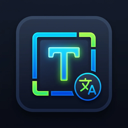

# my-translator-01

Manifest V3 架构 + 强制穿透防复制限制 + 离线 Tesseract.js 框选 OCR + 微软 Edge 免 Key 双引擎翻译。

<div align="center">

&#x20; 

&#x20; <h1>極速穿透劃詞與截圖翻譯 (Quick Penetrate Translator)</h1>

&#x20; <p>無畏網頁防複製限制的輕量級瀏覽器翻譯擴充功能 · 支援劃詞穿透、Alt 懸停與離線截圖 OCR</p>

</div>


\---


\## ✨ 核心特性


\- \*\*🛡️ 強制穿透網頁防複製限制\*\*：自動解除 CSS `user-select: none` 限制，並在事件捕獲階段（Capture Phase）優先監聽選區，完美解決小説網站、技術社區按鈕標籤及自定義右鍵選單劫持導致常規翻譯插件失效的問題。

\- \*\*🖼️ 離線框選截圖 OCR (`Alt + S`)\*\*：內建本地 WebAssembly 版 `Tesseract.js` 引擎與 Manifest V3 `Offscreen Document` 隔離架構，可直接框選網頁圖片、Canvas 畫布、PDF 掃描件或影片硬字幕進行離線文字辨識並即時翻譯。

\- \*\*⚡ 三種無縫觸發模式\*\*：

&#x20; 1. \*\*常規劃詞翻譯\*\*：滑鼠拖曳反白選取文字，自動在游標旁彈出暗黑風格 Shadow DOM 懸浮窗，支援一鍵複製譯文。

&#x20; 2. \*\*Alt 懸停穿透\*\*：按住鍵盤 `Alt` 鍵並將滑鼠移至無法反白選取的按鈕、導航列或標籤上，直接抓取文字翻譯。

&#x20; 3. \*\*區域截圖辨識\*\*：按下快捷鍵 `Alt + S` 拉起螢幕選框，拖曳框選任意畫面區域即可自動識別並翻譯。

\- \*\*🆓 零配置開箱即用\*\*：無需註冊帳號、無需綁定信用卡或配置付費 API Key，本地離線 OCR + 微軟翻譯雙引擎開箱即用。


\---


\## 📦 安裝方式（Chrome / Edge 通用）


1\. 下載本倉庫程式碼至本機（點擊右上角 `Code` -> `Download ZIP` 並解壓，或使用 `git clone`）。

2\. 開啟瀏覽器擴充功能管理頁面：

&#x20;  - \*\*Edge 瀏覽器\*\*：網址列輸入 `edge://extensions/`

&#x20;  - \*\*Chrome 瀏覽器\*\*：網址列輸入 `chrome://extensions/`

3\. 開啟頁面右上角的 \*\*「開發人員模式（Developer mode）」\*\* 開關。

4\. 點擊左上角的 \*\*「載入解壓縮的擴充功能（Load unpacked）」\*\*，選擇解壓後的專案資料夾即可完成安裝。


\---


\## 🎮 使用說明


| 操作方式 | 觸發條件 | 適用場景 |

| :--- | :--- | :--- |

| \*\*拖曳選取\*\* | 滑鼠左鍵框選反白文字後放開 | 常規網頁段落、文章、評論區 |

| \*\*懸停抓取\*\* | 按住 `Alt` 鍵 + 滑鼠懸停在元素上 | 網頁按鈕、側邊欄篩選標籤、禁止反白的 UI 文字 |

| \*\*截圖識別\*\* | 按下 `Alt + S` 拖曳框選螢幕區域 | 網頁圖片、漫畫/海報文字、Canvas 畫布、影片字幕 |

| \*\*設定面板\*\* | 點擊瀏覽器工具列上的擴充功能圖示 | 自訂快捷鍵、切換引擎或檢視狀態 |


\---


\## 🗂️ 專案結構


```text

├── manifest.json             # Manifest V3 核心設定檔

├── icon.png                  # 擴充功能圖示

├── background.js             # 後台 Service Worker（負責截圖裁剪與翻譯請求調度）

├── content.js                # 前台注入腳本（負責防複製穿透、選框繪製與 Shadow DOM 浮窗）

├── offscreen.html / .js      # MV3 離屏文件環境（繞過網頁 CSP 執行本地 WASM OCR）

├── popup.html / .js          # 工具列彈出設定視窗

├── tesseract.min.js          # Tesseract.js 核心庫

├── worker.min.js             # Tesseract 本地 Worker 腳本

├── tesseract-core.wasm.js    # WebAssembly OCR 運算核心

└── eng.traineddata.gz        # 英文離線辨識語言模型

📄 開源協議
本專案基於 MIT License 開源，歡迎自由使用、修改與二次開發。


---

### 提交前的最后一步提示
如果你在 `popup.js` 或 `background.js` 里有留给用户填写自定义接口的输入框，确认里面的默认值是空字

